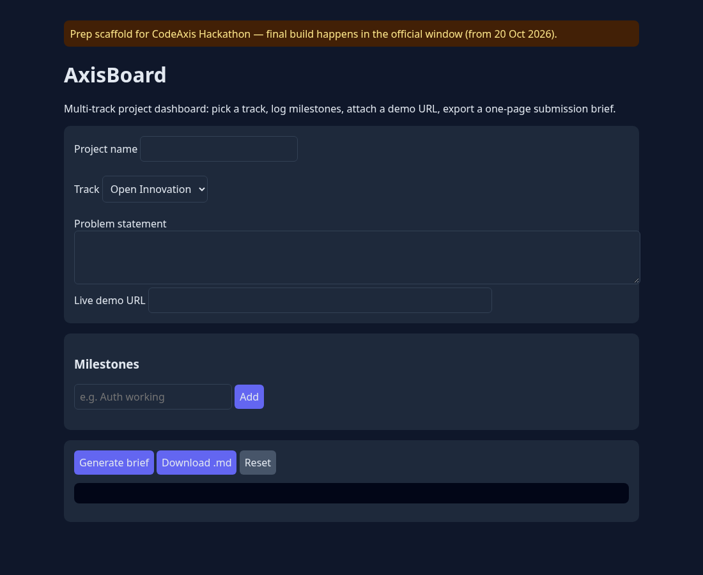

# AxisBoard

> **Prep work notice:** This is a pre-event prep scaffold for the **CodeAxis Hackathon** (WeCodeCoders, Unstop). The official build window opens **20 Oct 2026**; all substantive feature work for the submission will be done inside that window. Nothing here has been submitted.

A simple multi-track project dashboard: pick a problem track, log build milestones, attach a live demo URL, and export a one-page submission brief (Markdown).

**Demo:** http://edvera.me/axisboard/

## Run
No build step. Open `index.html` in a browser, or: `python3 -m http.server 8000` and visit http://localhost:8000. Data is kept in browser localStorage.

## Planned for the build window
Next.js port, multiple projects, team members, shareable brief link.
